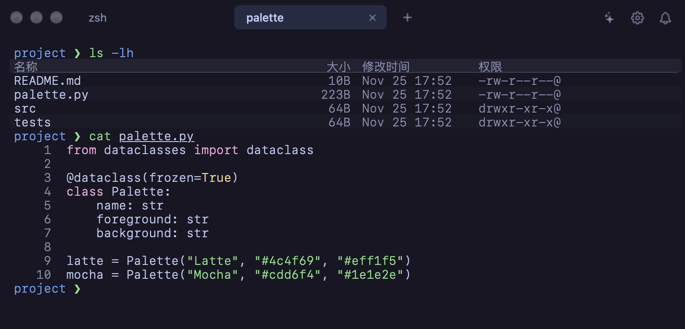

# YaaTerm

YaaTerm 是一款轻量的 macOS 原生终端。用标签页和分屏组织会话，在终端里直接读表格、看代码，或让 Agent 在当前 shell 中逐条执行命令。

[下载 macOS 版](https://github.com/yemaster/YaaTerm/releases/latest) · [文档官网](https://yemaster.github.io/YaaTerm/) · [使用指南](docs/usage.md) · [性能实测](docs/performance.md) · [反馈问题](https://github.com/yemaster/YaaTerm/issues)



## 安装

支持 macOS 13 及以上，发行包同时包含 Apple Silicon 和 Intel 版本。下载 Release 中的 `YaaTerm-<版本>-macOS.zip`，解压，将 `YaaTerm.app` 拖入「应用程序」后打开。首次安装包使用 ad-hoc 签名，尚未通过 Apple 公证。[下载最新发行版](https://github.com/yemaster/YaaTerm/releases/latest)

## 在终端里工作

| 想做什么 | 如何使用 |
| --- | --- |
| 同时处理多个会话 | ⌘T 新建标签，⌘D 左右分屏，⇧⌘D 上下分屏。标签可分组、收起，也可以拖到另一扇窗口。 |
| 阅读命令结果 | `ls -lh`、`docker ps`、`kubectl get pods` 等输出可切换表格与原始数据。`cat` 和 `nl` 支持代码高亮与行号。 |
| 找回之前的输出 | ⌘F 或 Ctrl+F 搜索当前分屏的回滚。按住 ⌘ 点网址可打开浏览器，点文件路径可在 Finder 中定位。 |
| 解释刚执行的命令 | 按 ⇧⌘E 查看命令、参数与输出的含义。命令失败时也可以点报错旁的「命令解释」，在当前提示符中编辑建议命令。 |
| 让 Agent 执行任务 | ⌘J 切到 `Agent >`，输入任务。命令显示在原分屏中，Enter 确认，Ctrl+C 取消。↑、↓ 翻阅任务历史。 |

表格、代码预览和内置 Agent 使用 zsh 集成。首次使用 AI 时，按 ⌘, 打开「设置 → AI 服务」，填写接口、模型和密钥。命令解释、Agent 和输出增强都可以分别关闭。[配置与快捷键](docs/usage.md)

## 性能

在同一台 Apple M5 上向三个终端内核重放相同的数据，得到以下吞吐量。单位为 MiB/s，越高越快。窗口网格为 100 × 32，关闭回滚，只计解析和网格更新。

| 输入 | YaaTerm | Ghostty VT | Alacritty Terminal |
| --- | ---: | ---: | ---: |
| 纯 ASCII 滚动日志 | 899 | **1,791** | 274 |
| 彩色中英文滚动日志 | **481** | 446 | 255 |
| 单行进度条反复刷新 | 2,726 | **3,481** | 343 |
| 光标定位、多行状态刷新 | 1,066 | **1,471** | 312 |

默认开启回滚。每个分屏的热回滚单元格缓存上限为 1 MiB，更早的行以 LZ4 压缩到会话临时文件，滚动和搜索时按需读取。[测试条件与复现步骤](docs/performance.md)

## 从源码运行

安装 Xcode Command Line Tools 后，在项目目录执行以下命令。首次构建会下载并校验 Sparkle。

```sh
make run        # 构建并打开 YaaTerm
make test       # 运行回归测试
make benchmark  # 重放百万行日志，测量默认回滚的吞吐与内存
```

日常提交由 GitHub Actions 构建和测试，通用安装包在对应运行的 Artifacts 中。重要更新通过版本标签发布，应用内可在「设置 → 关于」检查更新。[构建记录](https://github.com/yemaster/YaaTerm/actions) · [更新日志](https://github.com/yemaster/YaaTerm/releases)

<details>
<summary>发布重要版本</summary>

递增 `Info.plist` 中的版本号和构建号，在 `Resources/ReleaseNotes/` 添加对应版本的更新日志。合入默认分支后，给发布提交打上 `v<版本>` 标签并推送。Action 会校验标签、运行测试、签名并发布 Release 和 Sparkle 更新清单。签名沿用仓库 Secret `SPARKLE_PRIVATE_KEY` 和 `Info.plist` 中对应的公钥。

</details>
